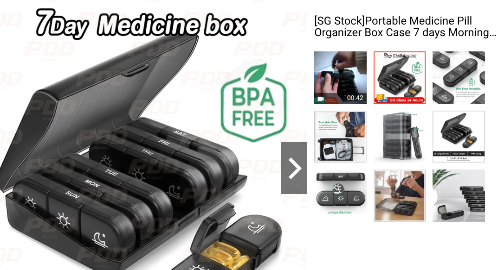

### Background                                                                                                                                           
I was hospitalised for 2 weeks, spending most of that time tied to a bed with tubes and needles                                                          stuck into me. I could walk into the hospital, but after surgery, I could hardly get out of bed
on my own.

Here are a few tips and notes to myself that could help you, or your loved one, experience
a better hospital stay or just age more comfortably.

### Sleep is important
Hospital wards can get noisy. Pack a sleep mask/eye shield and a pair of comfortable
ear plugs. This can help with a better night's sleep.

### Getting out of bed
1. Roll yourself to the edge of the bed.
1. Place one leg off the bed.
1. Use your arm/elbow as a lever to push yourself upright to a seating positing.
1. Get up from your seating position.

See also this short video: https://www.youtube.com/shorts/rBw_rhrApMo

### Walking is important
Gentle exercise and getting to view the sunlight is a great morale booster.

Use whatever walking aid you feel comfortable using. I use a pair of
trekking poles. These help with me with both walking uphill as well as
downhill.

See also this video: https://www.youtube.com/watch?v=jWm0V6_wldY

When climbing or going down stairs, hold on to the bannister / handrail.
Your arms/upper body help pull you up the stairs, and when going
down stairs, it reduces the impact to your knees.

Trekking poles work like the stair bannister.

### Medicine taking reminders

I build a calendar pdf meant to be printed double-sided on one sheet of paper.
Download it from:
https://app.beyondbroadcast.com/cal/

Be patient. It takes about 10 seconds to build.

Also search for favourite shopping site for 7-day pillbox.

